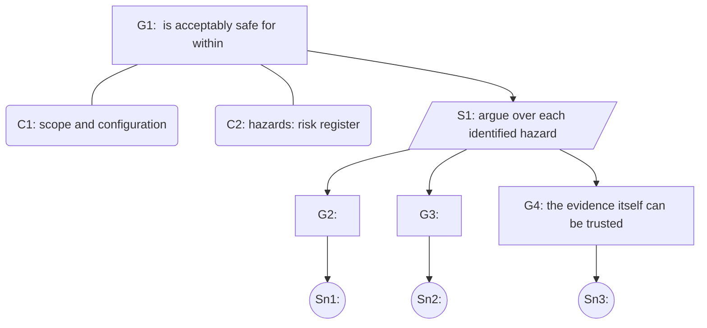

# Safety case: <target>

A structured argument, in [Goal Structuring Notation](https://scsc.uk/gsn) (GSN), that the
system is acceptably safe for a stated use. Each claim is supported by evidence or marked as
not supported; an honest "not supported" is the point of the exercise.

Notation: rectangles are goals (claims), parallelograms are strategies (how a claim is
broken down), rounded boxes are context, circles are solutions (evidence).

Colour each goal: supported (green), partially supported (amber), not supported (red).

## Claims and evidence

| Goal | Claim | Evidence | Verdict |
|---|---|---|---|
| G2 | | | |

## Conclusion

<Acceptable / not acceptable for the stated use, and the gaps that block it.>
